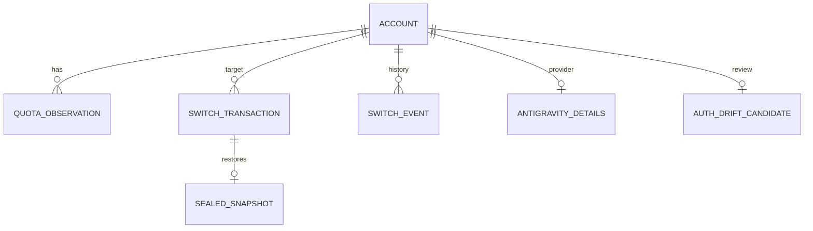

# Архитектура Egoist 3.2.0 RC

## Слои

Renderer (React) получает безопасные DTO через context-isolated preload. Main проверяет trusted sender, readiness startup и разрешённость операции. AccountManager координирует provider adapters, vault, SQLite, scheduler, write locks и recovery. Секретные столбцы AccountStore и вложенные токены исключаются на общем IPC/event boundary (`rendererDtoService`).

Electron сохранён: доказательства необходимости смены стека нет. Native discovery вынесено в worker; Credential Manager и остановка/запуск Antigravity имеют async adapters. Оболочка загружается из локального состояния до необязательной native discovery; изменения не принимаются до startup recovery.

## Хранение

SQLite сохраняет WAL + synchronous=FULL. Миграция 11 добавочная: quota/evidence не требуют сброса существующих профилей, IDs или настроек. Основной encryptedAuthJson остаётся в main; `ManagedAccount` содержит только публичные поля. Snapshot квот сохраняет исходные buckets и дробную точность; legacy five-hour/week aliases доступны только при фактических длительностях 300/10080 минут.

Технический appId `one.egoist.codex-account-manager`, repository name и существующий каталог данных отделены от видимого Egoist. Экспорт v1/v2/v3 сохраняется; новые записи импорта получают UUID и owned profileDir. Preview хранит encrypted records только в памяти, имеет срок действия и проверку revision; apply использует одну SQLite transaction, а каталоги создаются при hydration.

## Транзакция переключения

Provider keyed lock и общий cross-process lock используются применением, ручным откатом и startup recovery. Применение AG останавливает целевой owned процесс до записи. Sealed snapshot включает полный статический write-set, SQLite consistent image, исходное отсутствие файлов и Credential Manager. Manifest integrity связывает метаданные и присутствие credential snapshot.

Readback проверяет файловые bytes/SQLite значения и Credential Manager. Сбой записи, запуска или достоверный runtime mismatch вызывает восстановление. Неудачный readback/restore переводит транзакцию в recovery_required и блокирует новые изменения этого провайдера. Отдельные plaintext stages принадлежат transaction ID и удаляются ограниченной owned-cleanup, в том числе без manifest.

| Evidence | Codex | Antigravity |
|---|---|---|
| Профиль применён | Durable bundle/readback | Full profile writer/readback |
| Credentials | Официальный app-server probe | Google userinfo email + известный subject |
| Запуск | Проверенный lifecycle result | Quiesce/launch adapter |
| Runtime account | Desktop binding не подтверждён этой версией адаптера | GetUserStatus после OS binding и повторной проверки |

Отсутствие последнего уровня не маскируется: выбранный профиль остаётся применённым, sealed backup сохраняется, UI показывает неполное подтверждение, auto-switch запрещён. Runtime email не выдаётся за неизменяемую идентичность workspace.

## Scheduler и отмена

Единый RefreshScheduler имеет deduplication, AbortSignal, приоритет и concurrency=2. Provider lock обеспечивает одного владельца credential writes. Ответ принимается только для account ID, credential version и operation epoch; после await повторяется recovery gate. Последняя ошибка не заменяет last-good snapshot. Retry-After сохраняется; повтор ограничен. Google/AG transport ограничивает и headers, и body, отличает 401/403/429 и отменяет настоящий fetch.

## Test isolation и доставка

Isolated shipping probe требует UUID marker, token и шесть canonical contained directories. Guards блокируют общий Credential Manager, autostart, host discovery, provider network, внешние приложения/URL и desktop process control. Разрешённый development origin не может redirect к провайдеру. Результат readiness содержит version/nonce/PID и факт загрузки renderer.

Node и Electron SQLite ABI проверяются раздельно. Production package включает только необходимые main dependencies; renderer libraries остаются build-time. Canonical build создаёт portable и custom owned installer, а не default NSIS Setup. Installer manifest/hash preflight отвергает постороннюю папку/reparse/hardlink; uninstall удаляет лишь unchanged owned files.

RC локальный и unsigned. Публичная stable готовность требует Authenticode и применимых native guest checks. Live identity/конкурентные замеры невозможно заменить synthetic fixtures. Подробности: [release result](releases/3.2.0-rc.1.md), [verification protocol](benchmark-3.2.0.md).
