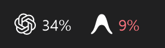
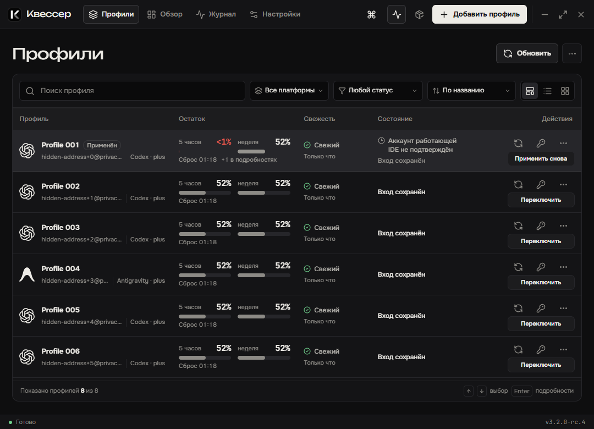

# Квессер 3.2.0-rc.4

Предварительная сборка для Windows x64, 19 ноября 2026. Установщик и portable выпускаются без цифровой подписи. Перед обновлением выберите «Выход» в контекстном меню индикатора Квессера. Данные профилей хранятся отдельно от каталога установки.

## Профили и окна

- Повторный импорт текущего сеанса Codex узнаёт сохранённый профиль после обновления токена. Квессер сверяет доступные адрес и идентификаторы профиля и рабочего пространства. При неоднозначном совпадении импорт предлагает подтвердить вход.
- При повторном входе другим пользователем исходный профиль сохраняется. Проверка активного профиля Codex больше не запрашивает ротацию токена из его отдельной копии.
- Для режимов Codex `keyring`, `auto` и `ephemeral` Квессер исключает остаточные файлы из импорта. Переключение файловых профилей поддерживается для `file`. Доступность браузерного входа, кода устройства, ключа API и корпоративного токена зависит от возможностей установленного Codex.
- Если окно Codex остаётся открытым для сохранения работы или приложение само перезапускается во время закрытия, переключение останавливается. После запуска Квессер проверяет появление нового процесса с окном. Восстановление прерванной операции может использовать уже открытое окно.
- Для нового входа Google нужен настроенный Desktop OAuth-клиент. Укажите `CAM_ANTIGRAVITY_OAUTH_CLIENT_ID` и, если он требуется, `CAM_ANTIGRAVITY_OAUTH_CLIENT_SECRET`. Для сохранённых разрешений Квессер учитывает идентификатор исходного клиента. Отказ Google принять настройки клиента оставляет сохранённые данные аккаунта на месте.

## Интерфейс

- Панель задач показывает ChatGPT и Antigravity рядом. У каждого контура свой процент. Остаток ниже 10% становится красным, а недоступный отображается тире. При наведении открывается карточка с лимитами, при щелчке доступны действия для выбранной платформы. При нехватке места остаётся один значок Квессера в трее.
- Навигация приложения находится сверху. Обзор, профили, журнал и настройки используют графитовые поверхности Egoist Lagom. Зелёный отмечает подтверждённые состояния и фокус, красный выделяет ошибки и критические лимиты.
- Список профилей поддерживает поиск, фильтры по платформе и состоянию, семь вариантов сортировки и режимы таблицы и карточек. В автоматическом режиме карточки появляются при ширине окна до 760 px.
- В подробностях профиля видны все наблюдаемые окна квот и проверка аккаунта работающей IDE. При отмене подтверждения переключения фокус возвращается к исходной кнопке.

## Границы проверки

Приёмка Windows x64 включает Vitest, Playwright, изолированный запуск упакованного EXE и проверки установки, обновления и удаления с контрольными суммами файлов. Для виджета проверены рисунок в системных темах, масштабы от 100% до 200%, граница 10% и размещение рядом с Wireless Battery при автоскрытии панели.

Переключение и восстановление проверяются на синтетических профилях и тестовых процессах. Реальный вход в Google или OpenAI и переключение действующих аккаунтов на рабочем компьютере в приёмку RC4 не входят. Сборка использует Electron 41.
